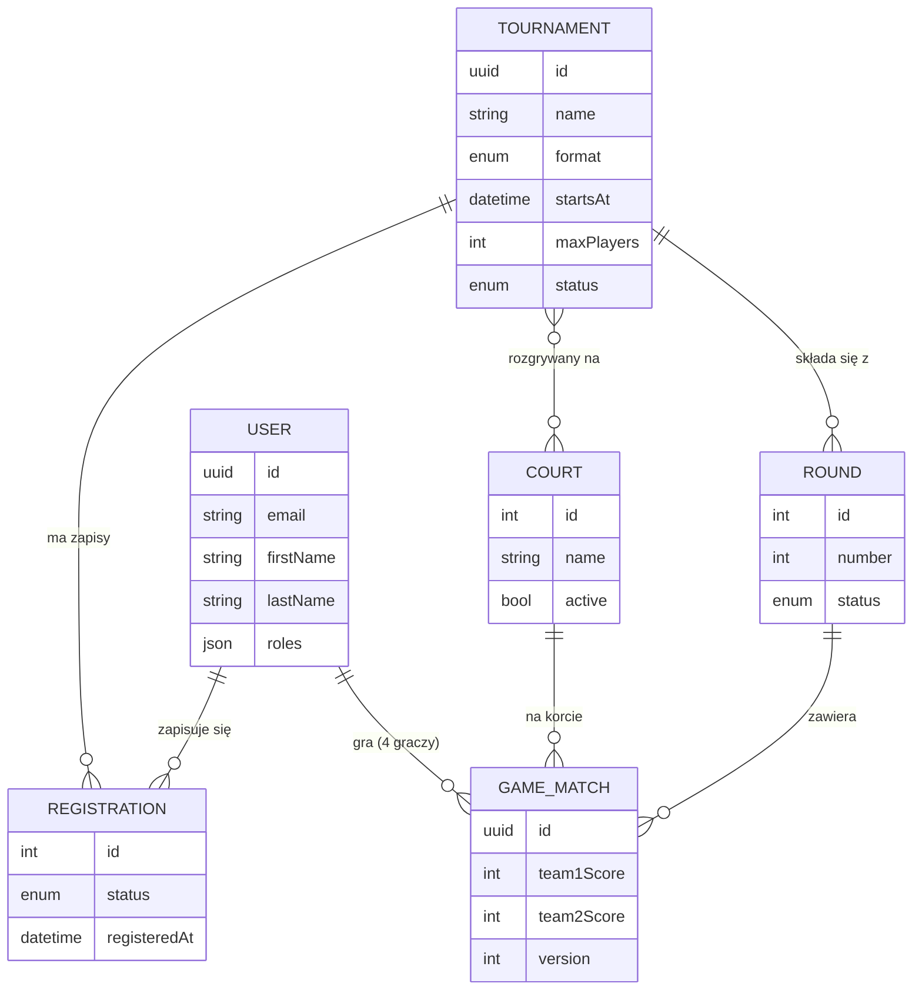

# PadelHub

Aplikacja do prowadzenia turniejów padlowych w formatach Americano i Mexicano.

## Struktura

```
backend/      Symfony 7.4 (REST API)
frontend/     React + Vite
compose.yaml  MariaDB, backend, worker Messengera, frontend, Mailpit
```

## Główne funkcjonalności

- **Konta i role** – rejestracja i logowanie (JWT). Rola `ROLE_PLAYER` dla graczy, `ROLE_ADMIN` dla organizatora.
- **Lista turniejów** – publiczna, stronicowana, z wyszukiwaniem po nazwie i filtrami statusu oraz formatu.
- **Zapisy** – gracz zapisuje się na turniej z otwartymi zapisami albo z niego rezygnuje. Po zapełnieniu miejsc trafia na listę rezerwową, a po zwolnieniu miejsca awansuje automatycznie (z e-mailem).
- **Rundy i mecze** – po starcie turnieju system sam dobiera pary i korty (Americano: rotacja partnerów, Mexicano: pary według rankingu). Kolejna runda powstaje dopiero, gdy wszystkie mecze mają wynik. Gracze dostają e-mail z nową rundą.
- **Wyniki i ranking** – wynik wpisuje gracz meczu (lub admin). Jednoczesne zmiany wyniku blokuje optimistic locking. Ranking liczony jest na bieżąco z punktów.
- **Panel administratora** – zarządzanie kortami, turniejami (szkic → zapisy → w trakcie → zakończony) i podgląd użytkowników.

## Model danych



- **Tournament** – turniej w formacie Americano albo Mexicano, rozgrywany na kilku kortach.
- **Registration** – zapis gracza na turniej (zapisany, rezerwowy albo wycofany).
- **Round** – kolejna runda turnieju.
- **GameMatch** – mecz dwóch par na danym korcie, z wynikiem i wersją do optimistic locking.

## Uruchomienie

Wymagany jest tylko Docker.

1. Skopiuj `.env.example` do `.env` i uzupełnij wartości (hasła do bazy, `APP_SECRET`, `JWT_PASSPHRASE` oraz hasła kont z fixtures).
2. Uruchom kontenery:

   ```bash
   docker compose up -d --build
   ```

   Przy starcie kontener backendu sam instaluje zależności (`composer install`), generuje klucze JWT i wykonuje migracje. Pierwsze uruchomienie trwa przez to dłużej.

3. Załaduj przykładowe dane:

   ```bash
   docker compose exec backend php bin/console doctrine:fixtures:load --no-interaction
   ```

   Fixtures tworzą konto `admin@padelhub.local`, graczy `gracz1@padelhub.local` … `gracz8@padelhub.local` oraz korty (Kort 1–3 aktywne, Kort 4 nieaktywny).

   Są też przykładowe turnieje:

   | Turniej | Stan |
   |---|---|
   | Mexicano dla wszystkich | zapisy otwarte, 0/8 graczy |
   | Wieczorne Americano | zapisy otwarte, 7/8 graczy – wystarczy zapisać `gracz1` i admin może wystartować |
   | Poranne Americano | w trakcie, runda 2 – mecz `gracz1` czeka na wynik |
   | Liga Mexicano | w trakcie, runda 2 bez wyniku |
   | Americano klubowe | zakończony, 3 rundy |
   | Mexicano dla zaawansowanych | zakończony, 3 rundy |

   Przy pierwszym starcie MariaDB tworzy też bazę testową `padelhub_test` (skrypt `docker/mariadb/create-test-database.sh`).

| Usługa | Adres |
|---|---|
| Frontend | http://localhost:5173 |
| API | http://localhost:8000/api |
| Swagger UI | http://localhost:8000/api/doc |
| Mailpit (podgląd e-maili) | http://localhost:8025 |

## Testy

Testy uruchamiamy w kontenerze, bo testy integracyjne korzystają z bazy `padelhub_test`:

```bash
docker compose exec backend php bin/console doctrine:migrations:migrate --env=test --no-interaction
docker compose exec backend php bin/phpunit
```

Sekrety (`APP_SECRET`, `JWT_PASSPHRASE`, hasła) są tylko w `.env`, który nie trafia do repozytorium. Przy uruchamianiu konsoli Symfony poza Dockerem trzeba je podać w `backend/.env.local` (razem z `DATABASE_URL`).
